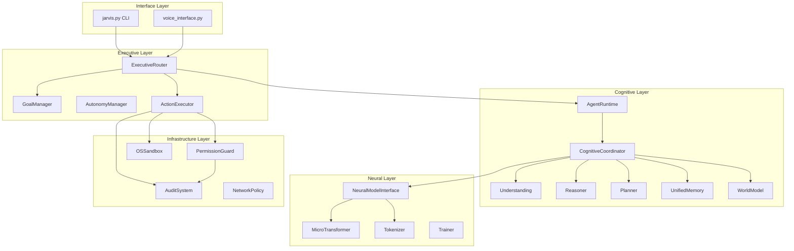

# Architecture

## 1. Architectural Layers



---

## 2. Component Details

### 2.1 Interface Layer
- **CLI** (`jarvis.py`): Interactive command-line interface. Instantiates `AgentRuntime` and `ExecutiveRouter`.
- **Voice** (`interface_layer/voice_interface.py`): Routes to `ExecutiveRouter`.

### 2.2 Executive Layer
- **ExecutiveRouter** (`executive_system/router.py`): Primary routing hub. Decides between identity, memory, knowledge, reasoning, and local routes. Wires into `AgentRuntime` when available.
- **GoalManager** (`executive_system/goal_manager.py`): Manages goal lifecycle (pending, in_progress, completed, failed).
- **AutonomyManager** (`executive_system/autonomy_manager.py`): Controls autonomous execution with permission checks.
- **ActionExecutor** (`executive_system/action_executor.py`): Executes approved actions with audit logging.

### 2.3 Cognitive Layer
- **AgentRuntime** (`cognitive_core/runtime/agent_runtime.py`): Top-level orchestrator implementing observe→understand→act→authorize→execute→verify→evaluate→replan loop. Manages task lifecycle (11 states), serializable `AgentState`, budget/deadline enforcement, and recovery.
- **CognitiveCoordinator** (`cognitive_core/coordinator.py`): Legacy orchestrator. Coordinates understanding, reasoning, planning, memory, knowledge, tools, and world model. Used as delegate by `AgentRuntime`.
- **Understanding** (`cognitive_core/understanding.py`): Rule-based intent/entity/relation extraction. 5 intent types (question, command, information, multistep, unknown).
- **Reasoner** (`cognitive_core/reasoning/reasoner.py`): Deductive reasoning with forward-chaining, hypothesis generation, tree-of-thought branching. Supports induce, classify, compare.
- **Planner** (`cognitive_core/planner.py`): Hierarchical goal decomposition into `Plan` with `PlanStep` (preconditions, effects, dependencies, fallbacks).
- **UnifiedMemory** (`cognitive_core/memory/unified_memory.py`): Composite memory orchestrating 7 subsystems with disk persistence.
- **WorldModel** (`cognitive_core/world_model/world_model.py`): Entity-relation-state tracking with causal predictions and simulation.

### 2.4 Neural Layer
- **NeuralModelInterface** (`neural_core/model_interface.py`): Single API for all JARVIS systems. Handles tokenization, generation, context windowing.
- **MicroTransformer** (`neural_core/network.py`): Pure NumPy transformer. 4 layers, 4 heads, d_model=128, d_ff=256, vocab_size=8590, max_len=256.
- **TorchMicroTransformer** (`neural_core/torch_model.py`): PyTorch/MPS port for GPU parity testing.
- **Tokenizer** (`neural_core/tokenizer.py`): Whitespace-mode tokenizer, 8,590 vocab, serializable.
- **Trainer** (`neural_core/trainer.py`): Full training loop with Adam optimizer, gradient clipping, checkpoint/resume.

### 2.5 Infrastructure Layer
- **PermissionGuard** (`INFRASTRUCTURE/security/permission_guard.py`): Regex-based blacklist (21 patterns, 17 blocked commands).
- **SecurityLayer** (`INFRASTRUCTURE/security/security_layer.py`): Wraps PermissionGuard + AuditSystem.
- **AuditSystem** (`INFRASTRUCTURE/audit/audit_system.py`): Structured event logging with 40+ event types and secret redaction.
- **OSSandbox** (`neural_core/os_sandbox.py`): OS-level process isolation. macOS: `sandbox-exec` MAC. Linux: `chroot` + `rlimits` + `setsid`.
- **NetworkPolicy** (`INFRASTRUCTURE/network_policy.py`): Host allowlist/blocked, protocol/port policy.

---

## 3. Data Flow

### 3.1 Normal Request Flow
1. User inputs text via CLI
2. `ExecutiveRouter.generate()` receives input
3. Router checks `agent_runtime` availability
4. If available: `AgentRuntime.run()` executes task loop
5. Inside loop: `CognitiveCoordinator.process()` handles understanding, reasoning, planning, memory, tools
6. `NeuralModelInterface.generate()` produces neural output if needed
7. Result verified, world model updated, memory persisted
8. Response returned to user

### 3.2 Tool Execution Flow
1. Tool requested via `ToolSystem.execute()`
2. `PermissionGuard.validate_command()` checks against dangerous patterns
3. If Python code: `PythonRunner.run_isolated()` applies 5-layer defense
4. Layer 5: `neural_core/os_sandbox.run_isolated()` forks child process
5. Child process runs under `sandbox-exec` (macOS) or `chroot`/`rlimits` (Linux)
6. Result captured, audited, returned

### 3.3 Training Flow
1. `train.py` prepares tokenizer, dataset, model, trainer
2. `Tokenizer.fit()` builds vocabulary from corpus
3. `Dataset` creates train/val/test splits with context window
4. `Trainer.train()` runs forward/backward with Adam optimizer
5. Checkpoints saved with lineage (code version, config, tokenizer state, dataset SHA256)

---

## 4. State Management

### 4.1 AgentState (`cognitive_core/runtime/agent_state.py`)
Serializable dataclass containing:
- `task_id`, `goal`, `subgoals`
- `current_plan`, `current_step`
- `belief_state`, `working_memory`, `relevant_memory`, `world_state`
- `observations`, `actions`, `action_results`, `verification_results`
- `failures`, `hypotheses`, `uncertainty`
- `permissions`, `budget`, `deadline`
- `agent_identity`, `capabilities`, `active_skills`
- `termination_reason`, `checkpoint`
- `schema_version`, `created_at`, `updated_at`

### 4.2 Task Lifecycle (`cognitive_core/runtime/task_lifecycle.py`)
11 states with strict transition matrix:
- QUEUED → RUNNING → PAUSED → WAITING_USER → WAITING_TOOL → WAITING_EXTERNAL → RECOVERING → FAILED → COMPLETED → CANCELLED → ABORTED

---

## 5. Deployment Architecture

Current deployment is **single-process, single-user**:
```
jarvis.py (main thread)
    ├── ExecutiveRouter
    ├── AgentRuntime
    ├── CognitiveCoordinator
    ├── NeuralModelInterface
    └── [All subsystems in-process]
```

No containerization, no orchestration, no distributed components.

---

*This document is part of the Technical Acquisition Package.*
